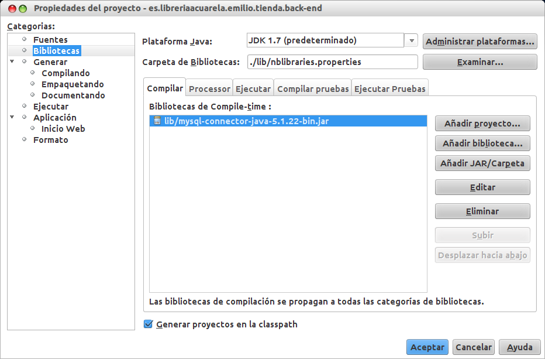

# JavaSQL

## Instalación y arranque, creación de BDs y tablas, introducción y visualización de datos

La instalación del gestor [MySQL](http://es.wikipedia.org/wiki/MySQL) bajo Ubuntu se hace de la forma habitual:  
```
$ sudo apt-get install mysql-server mysql-client
```
Durante la instalación del servidor se nos preguntará varias veces la contraseña del superusuario de la BD (root). Podemos dejarla vacía si, como en mi caso, solo vamos a hacer pruebas.
El servidor se encargará de almacenar las BDs y procesar las consultas. El cliente es un programa ligero que se conectará al servidor; así que podemos desplegarlos en máquinas diferentes si queremos trabajar en una arquitectura de producción más elaborada.
Una vez instalados, comenzamos a trabajar conectándonos al servidor. Como en mi caso he instalado ambos paquetes en la misma máquina, mi servidor será `localhost` pero podría usar la IP de otra si trabajo en computadoras separadas.  
```
$ mysql -h localhost -u root
```
El parametro -u define el usuario con el que nos conectamos. No confundir el usuario "root" de mysql con el usuario "root" del PC.
Esto nos lanzará el prompt del servidor, que queda identificado de la siguiente forma:  
```
mysql>
```
A partir de aquí nos moveremos con las órdenes SQL, las cuales terminan siempre con el caracter ";" (punto y coma). Si queremos introducir una instrucción muy larga podemos pulsar enter para emplear varias líneas, ya que el intérprete no enviará la sentencia al servidor mientras no encuentre el ";". Las líneas adiccionales cuentan con este prompt:  
```
->
```
Algo muy útil mientras estemos practicando, será activar que el intérprete nos muestre los WARNINGS (alertas) que se vayan produciendo.  
```
mysql> warnings
```
Si por el contrario queremos desactivarlos:  
```
mysql> nowarning
```
Para salir del cliente:  
```
mysql> quit
```
Estas y otras sentencias útiles las puedes consultar escribiendo:  
```
mysql> help
```

## Creación de bases de datos y tablas

En primer lugar veamos qué hay en el servidor:  
```
mysql> show databases;
```
Deberíamos obtener una salida como la siguiente:  
```
+--------------------+
| Database           |
+--------------------+
| information_schema |
| mysql              |
| performance_schema |
| test               |
+--------------------+
4 rows in set (0.00 sec)
```

Recuerda esta última orden porque te será útil para comprobar cambios relativos a las bases de datos.

En este ejemplo crearemos una base de datos llamada "tienda". En principio contendrá una tabla llamada "libros" en la que almacenaremos el código ISBN, el título, el autor, el precio y el stock de cada libro. Al menos por ahora. Si en el futuro nuestra tienda también pusiese a la venta CDs, haríamos una segunda tabla dentro de la BD. Podemos crear una nueva BD con:  
```
mysql> create database tienda;
```
Puedes verificarlo de nuevo:  
```
mysql> show databases;
+--------------------+
| Database           |
+--------------------+
| information_schema |
| tienda             |
| mysql              |
| performance_schema |
| test               |
+--------------------+
5 rows in set (0.00 sec)
```
Ahora deberíamos actuar sobre esta nueva BD, así que:  
```
mysql> use tienda;
```
Para crear la tabla "libros" con los campos de los que hablamos antes:  
```
mysql> create table libros(
-> isbn varchar(13) primary key not null,
-> titulo varchar(30) not null,
-> autor varchar (30) not null,
-> precio double not null,
-> stock int(4) not null
-> );
Query OK, 0 rows affected (0.18 sec)
```
Como se puede ver, dentro de los paréntesis que siguen a la palabra "libros" definimos los tipos de datos que vamos a almacenar. El ISBN, el título y el autor son cadenas de caracteres (varchar) a las cuales hemos limitado el tamaño (13, 30 y 30 respectivamente).  
El precio es un número con hasta dos cifras decimales (double) y el stock, un entero de hasta 4 cifras.  
Además hemos establecido que el ISBN sea la clave primaria, es decir, el valor inequívoco por el que se identificará a cada libro. Y ninguno de los campos puede ser nulo.  
Verificamos que la tabla se ha creado:  
```
mysql> show tables;
+--------------------+
| Tables_in_tienda   |
+--------------------+
| libros             |
+--------------------+
1 row in set (0.00 sec)
```
Y comprobamos la estructura inicial que hemos definido:  
```
mysql> describe libros;
+-----------+-------------+------+-----+---------+-------+
| Field     | Type        | Null | Key | Default | Extra |
+-----------+-------------+------+-----+---------+-------+
| isbn      | varchar(13) | NO   | PRI | NULL    |       |
| titulo    | varchar(30) | NO   |     | NULL    |       |
| autor     | varchar(30) | NO   |     | NULL    |       |
| precio    | double      | NO   |     | NULL    |       |
| stock     | int(4)      | NO   |     | NULL    |       |
+-----------+-------------+------+-----+---------+-------+
5 rows in set (0.01 sec)
```
Ahora vamos a introducir varios libros de ejemplo:  
```
mysql> insert into libros (isbn, titulo, autor, precio, stock) values(
-> '9788441529373',
-> 'Desarrollo de aplicaciones para Android',
-> 'Joan Ribas Lequerica',
-> 14.95,
-> 1
-> );
```
La sentencia dice literalmente que hay que introducir en "libros", rellenando los campos isbn, titulo, etc. un primer elemento, que es el fantástico libro de Lequerica "[Desarrollo de aplicaciones para Android](http://www.amazon.es/dp/844152937X)".  
El servidor rellenará los campos con la información proporcionada en ese mismo orden. Fíjate en que las cadenas de caracteres se delimitan con la comilla simple.
Metamos algo más de información en nuestra BD...
```
mysql> insert into libros (isbn, titulo, autor, precio, stock) values ('9701701658','Sistemas operativos diseño e implementación','Andrew S. Tanenbaum', 59.95, 1);
Query OK, 1 row affected, 1 warning (0.12 sec)

Warning (Code 1265): Data truncated for column 'titulo' at row 1
```
El warning que muestra se debe a que el titulo excede los 30 caracteres que habíamos previsto y la cadena de caracteres ha sido truncada. Otro más:  
```
mysql> insert into libros (isbn, titulo, autor, precio, stock) values ('9786074420463', 'Sistemas operativos modernos', 'Andrew S. Tanenbaum', 59.99, 1);
Query OK, 1 row affected (0.12 sec)
```
Ahora que tenemos tres elementos en la tabla libros de nuestra BD tienda, comencemos a visualizar la información. La orden que más vas a usar es la siguiente:  
```
mysql> select * from libros;
+---------------+---------------------------------+----------------------+--------+-------+
| isbn          | titulo                          | autor                | precio | stock |
+---------------+---------------------------------+----------------------+--------+-------+
| 9701701658    | Sistemas operativos diseño e i  | Andrew S. Tanenbaum  |  59.95 |     1 |
| 9786074420463 | Sistemas operativos modernos    | Andrew S. Tanenbaum  |  59.99 |     1 |
| 9788441529373 | Desarrollo de aplicaciones par  | Joan Ribas Lequerica |  14.95 |     1 |
+---------------+---------------------------------+----------------------+--------+-------+
3 rows in set (0.00 sec)
```
que como puedes ver, vuelca todo el contenido de la tabla.
Este tipo de sentencias basadas en expresiones regulares permite hacer selecciones de datos que cumplan unas determinadas condiciones; por ejemplo mostrar los libros con precio superior a 20 €.  
```
mysql> select * from libros where precio>20.00;
+---------------+---------------------------------+---------------------+--------+-------+
| isbn          | titulo                          | autor               | precio | stock |
+---------------+---------------------------------+---------------------+--------+-------+
| 9701701658    | Sistemas operativos diseño e i  | Andrew S. Tanenbaum |  59.95 |     1 |
| 9786074420463 | Sistemas operativos modernos    | Andrew S. Tanenbaum |  59.99 |     1 |
+---------------+---------------------------------+---------------------+--------+-------+
2 rows in set (0.03 sec)
```
O incluso combinar condiciones mediante los operadores lógicos habituales en programación:  
```
mysql> select * from libros where precio>20.00 && precio<59.99;
+------------+---------------------------------+---------------------+--------+-------+
| isbn       | titulo                          | autor               | precio | stock |
+------------+---------------------------------+---------------------+--------+-------+
| 9701701658 | Sistemas operativos diseño e i  | Andrew S. Tanenbaum |  59.95 |     1 |
+------------+---------------------------------+---------------------+--------+-------+
1 row in set (0.00 sec)
```
De la misma forma que para ver todas las columnas usamos el comodín \* y no ponemos ninguna condición (es decir, nada precedido por "where"), también podemos mostrar una única columna:  
```
mysql> select titulo from libros;
+---------------------------------+
| titulo                          |
+---------------------------------+
| Sistemas operativos diseño e i  |
| Sistemas operativos modernos    |
| Desarrollo de aplicaciones par  |
+---------------------------------+
3 rows in set (0.00 sec)
```
O mejor aún:  
```
mysql> select titulo from libros where autor='Joan Ribas Lequerica';
+--------------------------------+
| titulo                         |
+--------------------------------+
| Desarrollo de aplicaciones par |
+--------------------------------+
1 row in set (0.03 sec)
```
Esta última orden *selecciona* los *titulos* de la tabla *libros, donde* el *autor* sea el señor Lequerica. Obviamente en nuestro ejemplo solo encontrará uno.

## Actualización de datos, eliminación y alteración de las BDs y las tablas

Ahora intentaremos actualizar los datos de un elemento de la tabla, eliminar algún o algunos elementos y alterar la estructura de la tabla añadiendo o eliminando columnas. Comenzamos conectándonos al servidor de BDs:  
```
$ mysql -u root -h localhost
```
Y accediendo a nuestra BD "tienda":  
```
mysql> use tienda;
```
Y si hacemos:  
```
mysql> select * from libros;
```
Deberíamos poder ver los títulos que introdujimos con anterioridad. Si queremos cambiar un campo de todos los elementos, basta con usar la orden "update", indicar la tabla y hacer "set" sobre el atributo con el nuevo valor.  
```
mysql> update libros set stock=2;
```
Y sin embargo, si quisiéramos alterar un campo de un elemento concreto, haríamos lo mismo pero introduciendo una condición mediante "where":  
```
mysql> update libros set price=59.95 where title='Sistemas operativos modernos';
```
Para eliminar un elemento:  
```
mysql> delete from libros where isbn='9701701658';
```
O introduciendo una condición lógica para eliminar lotes de elementos:  
```
mysql> delete from libros where stock<0;
```
Tambien podemos eliminar elementos que cumplan que uno de sus campos pertenece a un conjunto dado:  
```
mysql> delete from libros where autor in ('Andrew S. Tanenbaum', 'Dan Brown', 'Joan Ribas Lequerica');
```
Ahora alteraré la estructura de la tabla, añadiendo una columna llamada "Editor":  
```
mysql> alter table libros add column editor varchar(30);
```
Puedo incluso modificar sus parámetros:  
```
mysql> alter table libros modify column editor varchar(30) not null;
```
Cambiar su nombre:  
```
mysql> alter table libros change column editor editorial varchar(30) not null;
```
O eliminarla:  
```
mysql> alter table libros drop column editorial;
```

## Consultas a MySQL desde un programa Java (I)

Para poder hacer consultas a una BD en MySQL desde un programa escrito en Java, necesitaremos una biblioteca intermedia llamada JDBC. Este conector lo incrustaremos en nuestros proyectos Java y será quién actúe de intermediario entre el código del programa y la interfaz del servidor MySQL.

La biblioteca del conector JDBC la tendremos que descargar desde:
<http://www.mysql.com/downloads/connector/j/>  
Como es independiente de la plataforma sobre la que se vaya a usar, descargamos el zip o el tarball, lo que prefiramos. Una vez lo tengamos, lo descomprimimos de la forma habitual. Por ejemplo:  
```
$ tar -zxvf mysql-connector-java-5.1.22.tar.gz
```
De todo lo que descomprime, lo que más nos interesa es el archivo mysql-connector-java-5.1.22-bin.jar. Por comodidad yo lo suelo almacenar en mi carpeta de proyectos de NetBeans para tenerlo siempre localizado.  
```
$ mv mysql-connector-java-5.1.22-bin.jar $HOME/NetBeansProjects/
```
En NetBeans tendremos que pulsar con el botón derecho sobre el proyecto que hayamos creado y pinchar en "Propiedades". Se abre un cuadro de diálogo. En la categoría "Bibliotecas" pinchamos sobre "Añadir JAR/Carpeta" y seleccionamos el archivo JAR del que hemos hablado.


Una vez hecho esto, ya podemos crear una clase en nuestro proyecto que maneje la conexión y las querys. En mi caso por ahora crearé la conexión con sus parámetros y luego un método con el que obtener la posibilidad de lanzar consultas.

Comenzamos con la clase a la que yo llamaré BDMgr.java. Primero importamos las librerías que permitan crear y configurar la conexión, así como la de sentencia y resultados:  
```
import java.sql.Connection;
import java.sql.DriverManager;
import java.sql.ResultSet;
import java.sql.Statement;
```
A continuación definimos la clase, sus parámetros y el método constructor que la instancia:  
```
public class BDMgr {
	private final static String driver="com.mysql.jdbc.Driver";
	private final String dbhost="localhost";
	private final String dbport="3306";
	private final String dbname="tienda";
	private final String dbuser="root";
	private final String dbpass="";
	private Connection ct;
	private Statement st;

	public BDMgr(){
		String dbconnection = "jdbc:mysql://"+dbhost+":"+dbport+"/"+dbname;
		try{
			Class.forName(driver);
			ct=DriverManager.getConnection(dbconnection,dbuser,dbpass);
			st=ct.createStatement();
			System.out.println("BDMGR: Conexión exitosa");
		}catch(Exception e){
			System.out.println("BDMGR ERROR: No se pudo conectar a la BD "+e.getMessage());
		}
	}
```
Es interesante destacar que aunque aquí las he marcado como final, las variables de la conexión podrían ser leídas desde un archivo de configuración...  
Necesitaremos también un método que nos proporcione la sentencia **st** que es mediante la cual realizaremos las consultas a la BD.  
```
	private Statement getSt(){
		return st;
	}
```
Al marcarlo como privado, nos aseguramos de controlar el acceso a la BD. Ahora definiremos las consultas que creamos oportunas. Por ejemplo:  
```
	public ResultSet parseQuery(String q){
		ResultSet rs=null;
		try{
			rs=getSt().executeQuery(q);
		}catch(Exception e){
			System.out.println("Error en la consulta: "+q);
		}
		return rs;
	}
```
Este método recibe una consulta q y devuelve un ResultSet; pero podríamos crear métodos específicos (seleccionar todos, seleccionar los que cumplen un requisito, etc.) y controlar mucho mejor qué consultas llegan al servidor SQL.
Algo muy interesante sería devolver una lista de elementos en lugar del ResultSet, para evitar tener que importar la librería en otras clases...

## Java y consultas a MySQL (II)

Comenzaré por crear una clase Libro que modele los objetos que estamos almacenando en la BD. Por comodidad solo he definido métodos de lectura y he sobreescrito el "toString()" (mediante "@Override") para que devuelva un String con los atributos separados por " || ".  
```
public class Libro {
    
    private String isbn;
    private String titulo;
    private String autor;
    private double precio;
    private int stock;
    
    public Libro(String i, String t, String a, double p, int s){
        isbn=i;
        titulo=t;
        autor=a;
        precio=p;
        stock=s;
    }
    
    public String getIsbn(){
        return isbn;
    }
    
    public String getTitulo(){
        return titulo;
    }
    
    public String getAutor(){
        return autor;
    }
    
    public double getPrecio(){
        return precio;
    }
    
    public int getStock(){
        return stock;
    }
    
    @Override
    public String toString(){
        return isbn+" || "+titulo+" || "+autor+" || "+precio+" || "+stock;
    }
    
}
```
Una vez definida la clase Libro, vamos a realizar unos pequeños cambios en la clase "BDMgr.java" que ya habíamos soslayado: vamos a pasar a privado el método con el que ejecutábamos una consulta (antes llamado "parseQuery", ahora llamado "get") y crear otro que transforme los resultados a un ArrayList de Libros tal que así:  
```
private static ResultSet get(String q){
        ResultSet rs = null;
        try {
            rs=st.executeQuery(q);
        } catch (SQLException ex) {
            Logger.getLogger(BDMgr.class.getName()).log(Level.SEVERE, null, ex);
        }
        return rs;
    }

private ArrayList<libro> getLibros(String q){
        ArrayList<libro> libros=new ArrayList();
        Libro unLibro;
        ResultSet rs=get(q);
        try {
            while (rs.next()){
                unLibro=new Libro(rs.getString("isbn"),rs.getString("titulo"),rs.getString("autor"),rs.getDouble("precio"),rs.getInt("stock"));
                libros.add(unLibro);
            }
        } catch (SQLException ex) {
            Logger.getLogger(BDMgr.class.getName()).log(Level.SEVERE, null, ex);
        }
        return libros;
    }
```
En cuanto al método "get()" no hay mucho que explicar: seguirá ejecutando la query que reciba.
Sin embargo el método "getLibros(String q)" sí que tiene algo de chicha. En la línea: `ResultSet rs=get(q);` enviamos la consulta y recogemos el ResultSet. Ahora en el try-catch podemos iniciar un bucle para cada elemento de "rs" en el que se crea el objeto "unLibro" con los atributos que leemos del elemento de "rs", y además lo añadimos al ArrayList.  
Fíjate que para leer los atributos hay que utilizar un método de ResultSet con el nombre de la columna donde se encuentra el dato. Por ejemplo: `rs.getString("titulo")` o: `rs.getDouble("precio")`

Una vez que tenemos esto, podemos ya definir métodos públicos que devuelvan colecciones habituales de Java:  
```
    public ArrayList<Libro> getLibros(){
        return getLibros("select * from libros;");
    }
    
    public ArrayList<Libro> getLibrosConISBN(String isbn){
        return getLibros("select * from libros where isbn="+isbn+";");
    }
```
Esos ArrayList serán mucho más cómodos de manejar que los ResultSet, y harán que nuestra aplicación sea independiente de la tecnología de bases de datos que usemos, porque ya no tendrán que preocuparse de importar estas clases.  
Y ¿si queremos insertar, modificar, eliminar? Dentro de "get()" estamos utilizando "executeQuery()" pero este método no nos sirve para este tipo de operaciones y lanzará excepciones. Así que crearé un método "set()" apropiado:  
```
    private static void set(String q){
        try {
            st.executeUpdate(q);
        } catch (SQLException ex) {
            Logger.getLogger(BDMgr.class.getName()).log(Level.SEVERE, null, ex);
        }
    }
```
El código es bastante similar excepto por el uso de "executeUpdate()" y porque no se retorna ningún valor. Mediante mi método "set()" ya puedo implementar otros, como por ejemplo:  
```
    public void venderLibro(Libro l){
        int nuevoStock=l.getStock()-1;
        String isbn=l.getIsbn();
        set("update libros set stock="+nuevoStock+" where isbn="+isbn+";");        
    }
```
Como ves, estas pequeñas operaciones de ejemplo son muy sencillas (y probablemente inseguras porque no hago ningún tipo de comprobación...) pero creo que reflejan muy claramente la mecánica de trabajo con una BD desde una aplicación Java.  
Podemos correr alguna prueba creando un pequeño "main()" que yo situaré en una clase llamada "Programa.java":  
```
public class Programa {
    
    public static void main(String[] args){
        BDMgr bdm=new BDMgr();
        ArrayList libros;
        System.out.println();
        
        System.out.println("Mostrar todos los libros");
        libros=bdm.getLibros();
        for (Libro l : libros){
            System.out.println (l.toString());
        }
        System.out.println();
        
        System.out.println("Mostrar un libro con ISBN 9788441529373");
        libros=bdm.getLibrosConISBN("9788441529373");
        for (Libro l : libros){
            System.out.println(l.toString());
        }
        System.out.println();
        
        System.out.println("Vender ese libro");
        libros=bdm.getLibrosConISBN("9788441529373");
        for (Libro l : libros){
            bdm.venderLibro(l);
        }
        System.out.println();
        
        System.out.println("Mostrar todos los libros");
        libros=bdm.getLibros();
        for (Libro l : libros){
            System.out.println(l.toString());
        }
        System.out.println();
    }
    
}
```
Si lo ejecutas, debería mostrar todos los libros en la BD, luego el libro de Joan Ribas Lequerica y por último de nuevo todos los libros pero esta vez deberíamos ver cómo el stock ha disminuido.